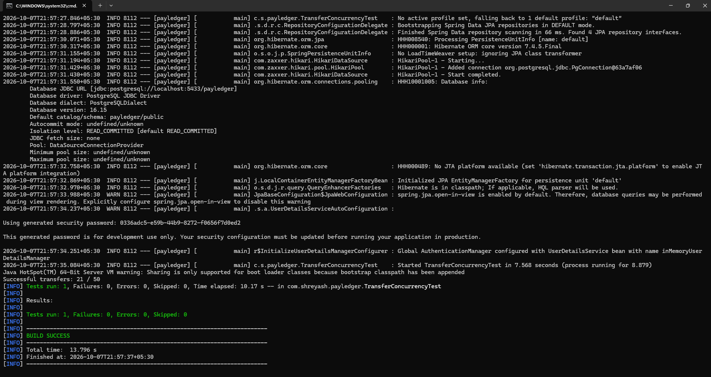
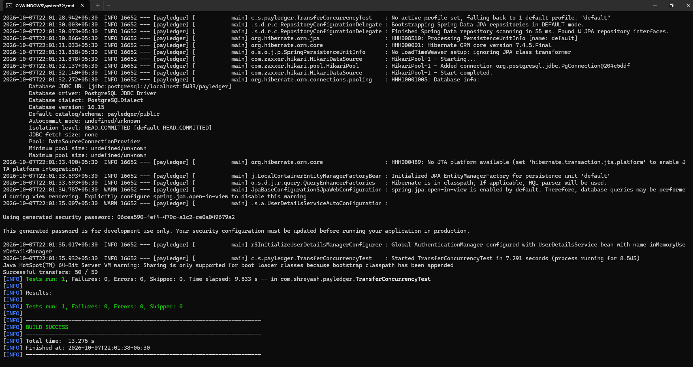
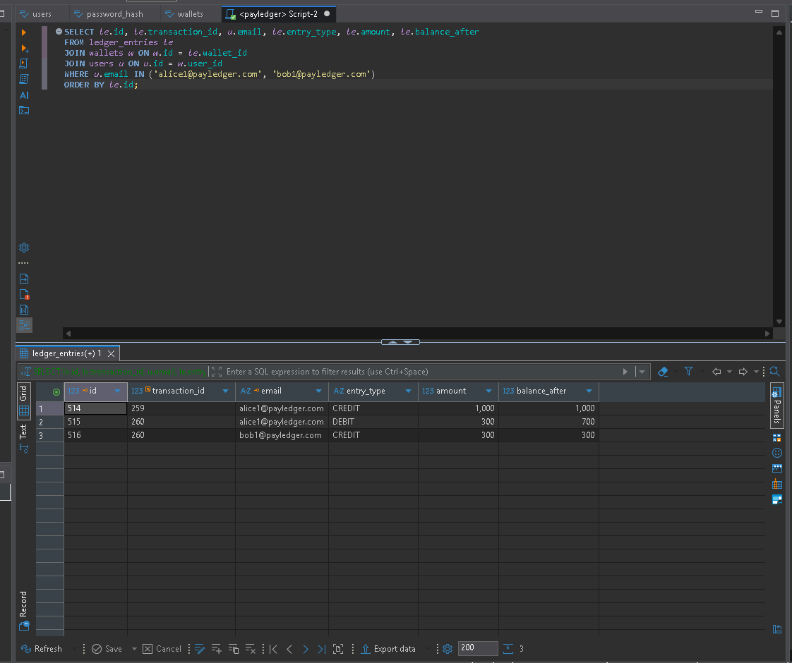

# PayLedger: Digital Wallet & Ledger API

A Spring Boot REST API for a digital wallet with a double-entry ledger, idempotent
transfers and concurrency-safe balance updates.

**Live demo:** _coming soon_ (free hosting, first request may take ~30s)

## Features
- JWT authentication (register, login, BCrypt password hashing)
- Wallet created automatically on signup
- Deposit and wallet-to-wallet transfer, atomic via `@Transactional`
- `Idempotency-Key` header: a repeated request never moves money twice
- Double-entry ledger: every transfer writes one DEBIT and one CREDIT entry
- Paginated transaction history
- Consistent JSON errors via a global exception handler (400, 401, 404, 409, 500)

## Tech stack
Java 17, Spring Boot, Spring Security, Spring Data JPA/Hibernate, PostgreSQL, Maven, JUnit, Docker

## Architecture
Security filter (JWT) -> Controller -> Service -> Repository -> PostgreSQL

Business logic lives only in the service layer. Balances change only through ledger entries.

## Concurrency: what I tested and what I changed
I wrote a test that fires 50 concurrent transfers from one wallet.

| Approach | Transfers succeeded | Balances consistent |
|---|---|---|
| Optimistic locking (`@Version`) + 5 retries | 21 / 50 | Yes |
| Pessimistic locking (`SELECT ... FOR UPDATE`), wallets locked in a fixed order | 50 / 50 | Yes |

Under heavy contention on a single wallet, optimistic locking lost many valid transfers
to version conflicts. Switching to pessimistic locking fixed that, and locking wallets in
a consistent order prevents deadlocks.

## API
| Method | Endpoint | Description |
|---|---|---|
| POST | /api/auth/register | Register, returns JWT |
| POST | /api/auth/login | Login, returns JWT |
| GET | /api/wallet | My wallet balance |
| POST | /api/wallet/deposit | Deposit (needs `Idempotency-Key` header) |
| POST | /api/transfers | Transfer (needs `Idempotency-Key` header) |
| GET | /api/transactions?page=0&size=10 | Transaction history |

Import `docs/PayLedger.postman_collection.json` into Postman and create an environment with
`baseUrl`, `tokenA`, `tokenB`, `emailB`.

## Run locally
1. Start PostgreSQL:
   `docker run --name payledger-db -e POSTGRES_PASSWORD=secret -e POSTGRES_DB=payledger -p 5433:5432 -d postgres:16`
2. `./mvnw spring-boot:run`
3. Run tests: `./mvnw test`

Configuration is read from environment variables with local defaults:
`DB_URL`, `DB_USER`, `DB_PASSWORD`, `JWT_SECRET`. Set your own `JWT_SECRET` in production.

## Author
Shreyash Gawande · [GitHub](https://github.com/Shreyash9330) · [LinkedIn](https://linkedin.com/in/shreyash-gawande9330)
